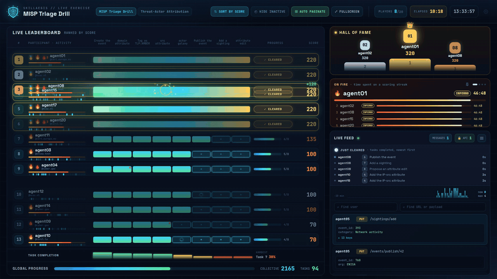
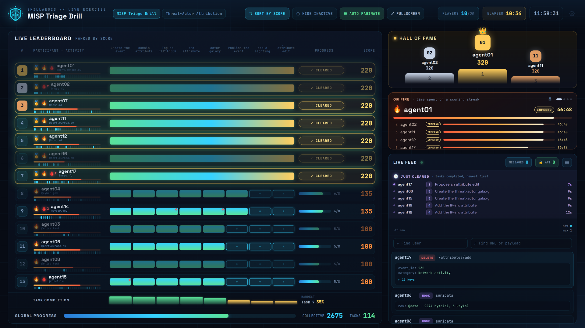
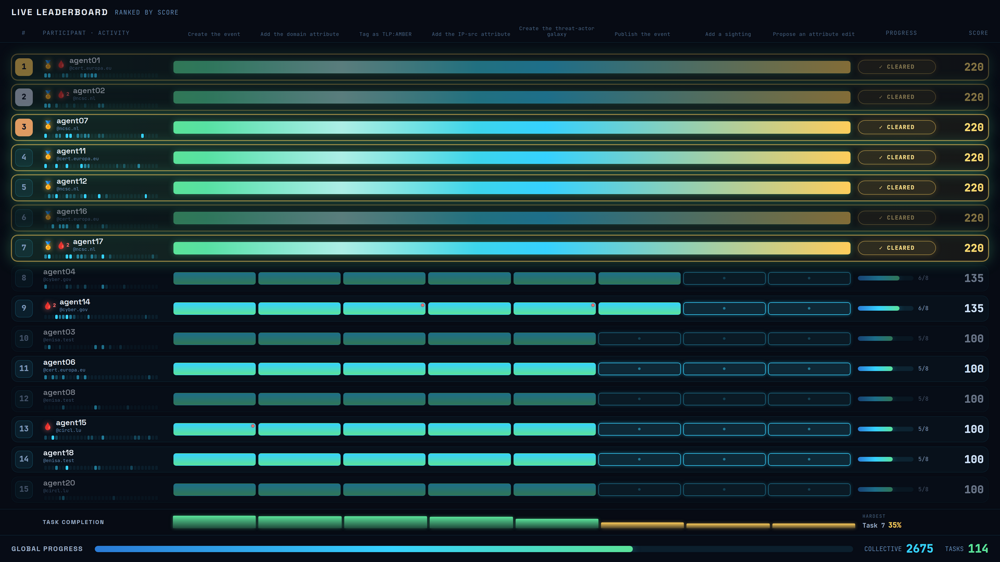

# SkillAegis-Dashboard
 

**SkillAegis-Dashboard** is a platform to run a training session and visualize the progress of participants in real-time.

The Dashboard runs scenarios authored in the [Common Exercise Format (CEXF)](https://misp.github.io/cexf/) with tools such as the **[SkillAegis Editor](https://github.com/MISP/SkillAegis-Editor)**.

> [!NOTE]  
> Consider running this application with **[SkillAegis](https://github.com/MISP/SkillAegis)** for Production.


*Short demo of SkillAegis-Dashboard: Once the application starts, the user selects an exercise. From that point, the application tracks the real-time progression of each players.*


*On the dashboard main page, you can monitor the progress of all participants for the selected exercise and view real-time logs of their activity feed.*


*The fullscreen view provides an overview of the status of all users in a single, easily accessible display.*


## Features

- **Real-time leaderboard** — ranks every participant live with per-task progress and scores, a task-completion chart that flags the hardest task, and automatic pagination for large groups.
- **Live activity feed** — a streaming log of participant activity (MISP events, webhooks and tool calls) with verbose / API-only filters and per-user or per-target search.
- **Player drill-down** — click any participant for a detailed view of their task-by-task progress, activity timeline and searchable event history.
- **Gamification** — scoring, trophies, "on fire" scoring streaks, a Hall of Fame podium, rotating champions and celebratory all-clear bursts keep sessions engaging.
- **Presentation & operations** — a fullscreen big-screen overview, a live-connection health indicator (LIVE / NO LIVE DATA / OFFLINE), an authenticated admin panel and a reduce-motion accessibility toggle.
- **CEXF-native** — runs any scenario in the [Common Exercise Format](https://misp.github.io/cexf/), designed with the [SkillAegis Editor](https://github.com/MISP/SkillAegis-Editor).


## Installation

To get started with SkillAegis-Dashboard, follow these steps:

0. Ensure Python **3.10** or higher is installed.
    ```bash
    python -V
    ```
1. Set up the backend virtual environment and install its dependencies.
   ```bash
   cd backend
   python3 -m venv venv
   source venv/bin/activate
   pip3 install -r requirements.txt
   ```
2. Create the configuration file and adapt it to your needs.
    ```bash
    cp config.py.sample config.py
    cd ..
    ```
3. Start the application — it serves the dashboard on <http://localhost:4001>.
   ```bash
   # Usage: ./start.sh --exercise_folder <folder> [--host <host>] [--port <port>]
   ./start.sh --exercise_folder scenarios/
   ```

## Development

### Back-end

The backend is an **aiohttp + Socket.IO** server (`backend/`) that subscribes to MISP over
ZeroMQ. Run it the same way as in production, pointing it at a scenarios folder:

```bash
./start.sh --exercise_folder scenarios/
```

To replay a recorded ZeroMQ session instead of subscribing to a live MISP feed:

```bash
python3 backend/main.py --exercise_folder scenarios/ --zmq_log_file <file>
```

### Front-end (Vite, port 5173)

```sh
npm install          # install dependencies
npm run dev          # hot-reload dev server (connects to the backend on :4001)
npm run build        # production build to dist/
npm run lint         # lint with ESLint (--fix)
```

### Testing the dashboard (mock server)

To develop the dashboard UI without MISP, Docker, scenarios or ZeroMQ, run the mock Socket.IO
server. It serves synthetic, animated data on `:4001` using the same event contract as the real
backend:

```sh
./start-mock.sh        # serve synthetic data on :4001 (instead of ./start.sh)
npm run dev            # then open the Vite URL it prints
```

Run the mock **or** the real backend, not both — in DEV the frontend connects to `:4001`. The
mock starts in admin mode (any login credentials are accepted); pass `--unauth` to start as a
viewer. Other flags: `--players N`, `--tick S`, `--port P`, `--no-sim` (start frozen),
`--seed N` (reproducible world).

To force a headline state without the admin panel, POST to the dev-only controls — e.g.
`curl -X POST http://localhost:4001/mock/clear/1` makes player 1 clear everything (the all-clear
burst). Available: `pause` / `resume` (freeze for screenshots), `clear` (everyone clears),
`clear/<user_id>`, `checking/<user_id>` (fire a "being validated" pulse on a player's next
available task — drives the per-task spinner), `empty` (wipe the board), `reset` (rebuild the
world), `zmq-stale` / `zmq-fresh` (freeze / resume the reported ZMQ time — drives the Live Feed
freshness light amber "NO LIVE DATA"; stopping the mock drops the socket → red "OFFLINE").

This is a UI harness only — it does not run the evaluation engine. See
[`docs/PRD-ui-testing.md`](./docs/PRD-ui-testing.md).


# License
This software is licensed under GNU Affero General Public License version 3

```
Copyright (c) 2024 Sami Mokaddem
Copyright (c) 2024 CIRCL - Computer Incident Response Center Luxembourg
```
